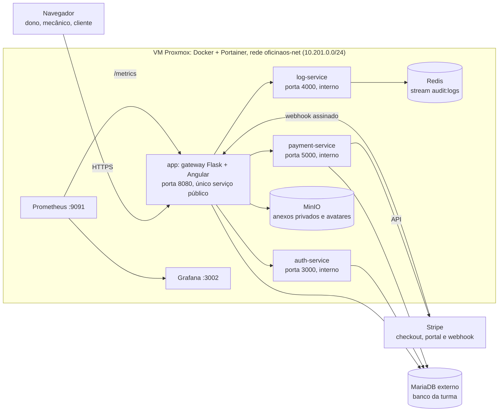
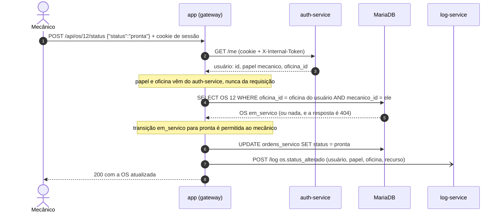
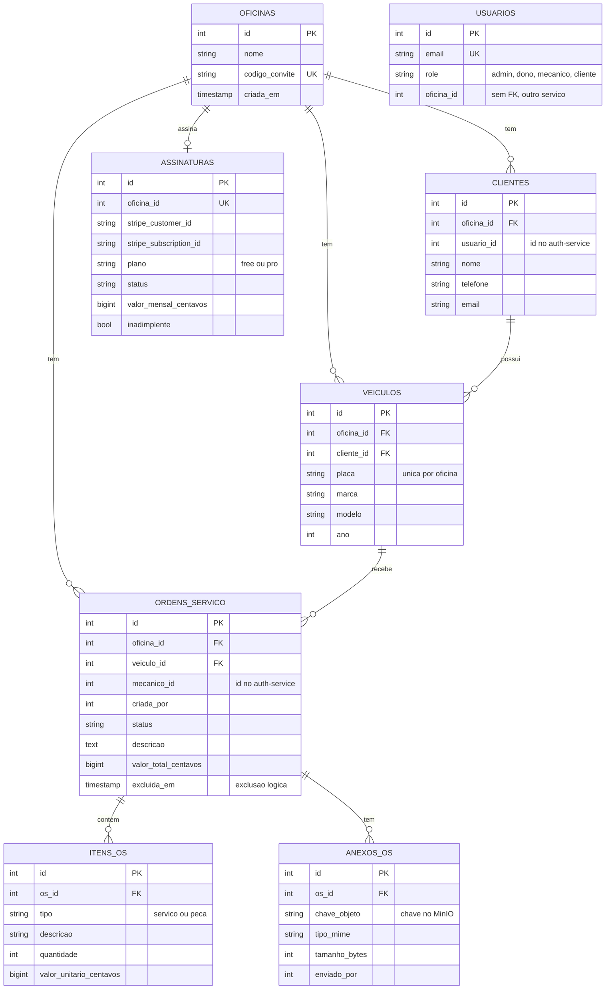

# Documentação do OficinaOS

Ordens de serviço para oficinas mecânicas pequenas. Esta é a documentação técnica do sistema **como ele está no ar**. O plano de negócio (dor, persona, Lean Canvas e planos) está no [README](README.md).

## 1. Especificação

Cada **oficina** é um *tenant*. O **dono** cadastra clientes e veículos e abre ordens de serviço (OS); o **mecânico** atende as OS atribuídas a ele; o **cliente** acompanha as OS do próprio veículo e aprova o orçamento; o **admin** é o administrador da plataforma (auditoria global e, na Atividade 11, planos e MRR de teste).

Fluxo de uma OS: o dono (ou o mecânico) abre a OS para um veículo → o orçamento é montado com itens (serviço ou peça) → o cliente aprova → o mecânico inicia o serviço, anexa fotos e marca como pronta → o dono entrega o veículo. O dono pode cancelar antes da entrega.

## 2. Arquitetura

| Serviço | Porta | Papel | Público? |
|---|---|---|---|
| `app` | 8080 | Gateway Flask: API do domínio, proxies, Swagger, build estático do Angular | **sim** |
| `auth-service` | 3000 | Login, sessão, papéis, `oficina_id`, perfil e avatar | não |
| `log-service` | 4000 | Eventos de negócio e auditoria em Redis Streams | não |
| `payment-service` | 5000 | Stripe: checkout, portal, webhooks e assinatura (Atividade 11) | não |
| `redis`, `minio` | internas | Stream/cache e armazenamento de objetos | não |
| `prometheus`, `grafana` | 9091, 3002 | Métricas e dashboards | não |

O MariaDB é **externo** (banco da turma). Os serviços internos se autenticam entre si com o cabeçalho `X-Internal-Token`.

### Fluxo de uma requisição

## 3. Regras de negócio

- **Tenant:** toda tabela do domínio tem `oficina_id` (direto ou via `os_id`). O `oficina_id` vem sempre do usuário autenticado.
- **Papéis:** `admin`, `dono`, `mecanico` e `cliente` (matriz completa no README, seção 11). Usuários antigos com papel `usuario` viraram `dono` sem oficina e passam pelo onboarding "Crie sua oficina".
- **Status da OS:** `aberta` → `orcamento_aprovado` → `em_servico` → `pronta` → `entregue`; `cancelada` só pelo dono antes da entrega. Transição inválida responde 409. O orçamento só pode ser aprovado se tiver valor.
- **Total da OS:** soma de `quantidade × valor_unitario_centavos` dos itens. Dinheiro sempre em centavos (inteiro).
- **Exclusão:** lógica (`excluida_em`); a OS excluída continua contando na cota do mês.
- **Limites do plano Free:** 20 OS por mês, 1 mecânico, 3 anexos por OS (resposta 402). Constante `PLANOS` em `backend/planos.py`.
- **Anexos:** PNG, JPEG ou WEBP validados pelos bytes, até 5 MB, em bucket **privado** (`oficinaos-anexos`), lidos só pela rota do gateway com checagem de papel e oficina. A chave do objeto nunca vai ao navegador.
- **Eventos no log:** `oficina.criada`, `membro.entrou`, `cliente.criado`, `veiculo.criado`, `os.aberta`, `os.editada`, `os.item_adicionado`, `os.status_alterado`, `os.orcamento_aprovado`, `os.entregue`, `os.cancelada`, `os.excluida`, `anexo.enviado`, `acesso_negado`, `plano.limite_atingido` (e, na Atividade 11, os de assinatura), além de login, logout e erro. Cada evento guarda usuário, papel, oficina, recurso e hora, sem dados pessoais sensíveis no detalhe.

## 4. Modelo de dados

`usuarios` pertence ao auth-service e `assinaturas` ao payment-service. `usuario_id`, `mecanico_id` e `usuarios.oficina_id` são **inteiros sem chave estrangeira**, porque cada serviço tem migrações independentes (Alembic por serviço) e não compartilha tabelas: o vínculo é validado pela aplicação (o gateway só aceita como mecânico quem a consulta ao auth-service confirma ser mecânico daquela oficina). O SQL versionado está em `db/`.

## 5. Segurança

- Autorização por papel **sempre no backend** (`require_roles`); a interface apenas esconde botões.
- Isolamento por oficina com 404 (não 403), para não confirmar a existência de registros de outras oficinas.
- Segredos só no `.env` local e nas variáveis da stack; `.env.example` contém apenas nomes.
- O `auth-service`, o `log-service` e o `payment-service` não têm porta publicada.
- O perfil de um usuário só pode ser lido pelo próprio, por admin ou por alguém da mesma oficina.
- Stripe somente em modo de teste; assinatura do webhook sempre validada; nenhum dado de cartão no sistema.

## 6. Observabilidade, qualidade e entrega

`/health` com readiness real (banco, auth, log, MinIO), `/metrics` coletado pelo Prometheus e dashboard no Grafana. Swagger agregado em `/docs`, com teste de paridade rota × especificação. CI/CD: testes → imagens `oficinaos-*` no GHCR → webhook do Portainer → smoke test em `/health`.

## 7. IaaS / PaaS / SaaS

Veja a classificação completa no README, seção 10: a VM, a rede e o Docker são **IaaS**; Portainer, MariaDB da turma, Redis, MinIO e o monitoramento são **PaaS**; o OficinaOS é **SaaS** para as oficinas, e consome Stripe, Google OAuth, Mailtrap e GitHub como **SaaS**.

## 8. Histórico do projeto

A origem do projeto (catálogo de filmes das Atividades 1 a 8) está preservada, só para consulta, em [docs/historico-documentacao-tomhanks.md](docs/historico-documentacao-tomhanks.md).
