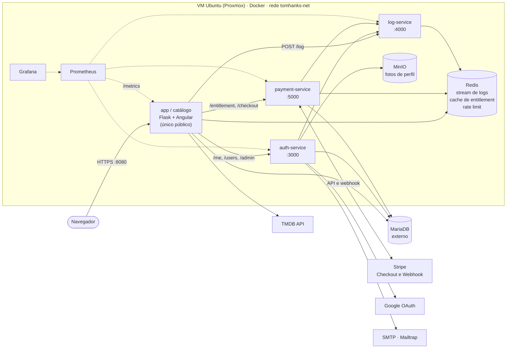
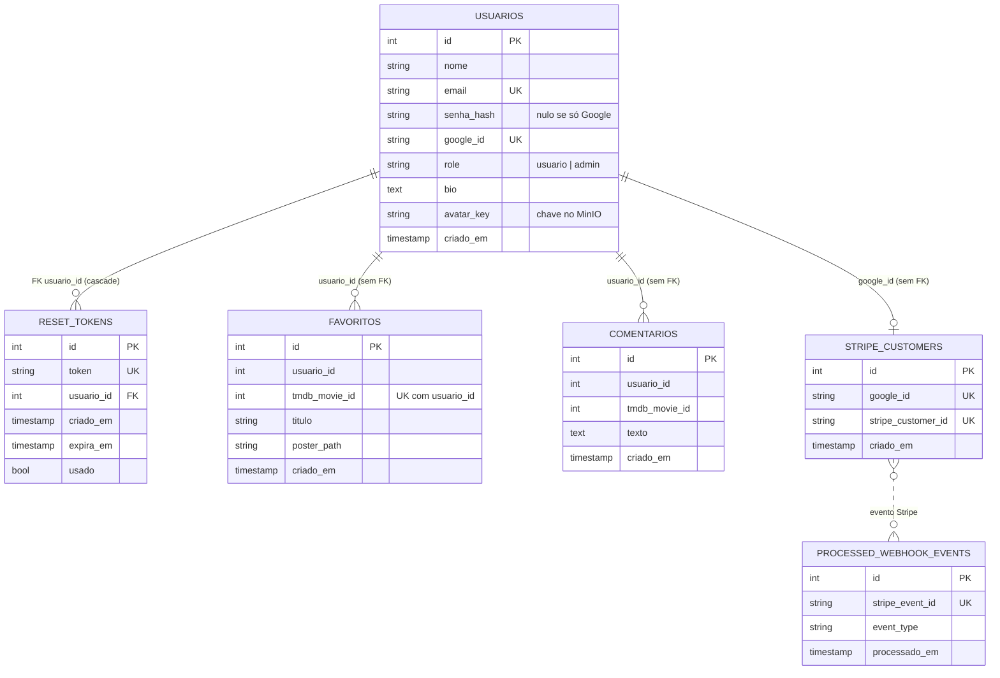

# Documentação reversa — Catálogo Tom Hanks

> Atividade 8 de ISW055 (Fatec Pompeia, professor [@siriani](https://github.com/siriani)).
> Escrita como se eu tivesse herdado o código de outra pessoa: tudo abaixo foi extraído lendo o código no commit `41497c4` (23/10/2026), com o arquivo e a função de origem entre parênteses. Onde o comportamento me pareceu estranho, eu registro como **Observação**.

Índice: [1. Especificação](#1-especificação) · [2. Arquitetura](#2-arquitetura) · [3. Regras de negócio](#3-regras-de-negócio) · [4. Modelo de dados](#4-modelo-de-dados)

---

## 1. Especificação

O sistema é um catálogo web dos filmes do ator Tom Hanks, com contas de usuário, favoritos, comentários, perfil com foto e um plano pago (Premium). Quem usa o sistema são três perfis.

| Perfil | O que faz |
|---|---|
| **Visitante** | Cria conta, entra com e-mail e senha ou com Google, pede link de recuperação de senha. Não vê o catálogo. |
| **Usuário** (`usuario`) | Vê o catálogo, favorita filmes, comenta, edita o próprio perfil e foto, assina o Premium. |
| **Administrador** (`admin`) | Tudo do usuário, mais: lista usuários, muda o papel de um usuário, apaga qualquer comentário, consulta o log de auditoria e o painel de infraestrutura. |

### Fluxos do ponto de vista de quem usa

1. **Cadastro e login.** O visitante informa nome, e-mail e senha (mínimo 6 caracteres) e já entra logado. Pode também entrar com a conta Google. Se esqueceu a senha, informa o e-mail e recebe um link que vale 30 minutos e só funciona uma vez.
2. **Catálogo.** Depois de logado, a pessoa vê a lista de filmes de Tom Hanks (dados da TMDB, em pt-BR) com pôster, e indica quais já favoritou e comentou. Se a TMDB cair, o sistema mostra o último catálogo carregado com um aviso.
3. **Favoritos.** Um clique favorita ou desfavorita um filme. Cada pessoa só enxerga e altera os próprios favoritos.
4. **Comentários.** A pessoa escreve comentários (até 4000 caracteres) sobre um filme e pode apagar os seus.
5. **Perfil e avatar.** Cada pessoa edita nome e bio (até 500 caracteres) e envia uma foto (PNG, JPG, WEBP ou GIF, até 5 MB). A foto fica no MinIO; o banco guarda só a chave.
6. **Plano Premium.** A pessoa logada com Google clica em assinar, é levada ao Checkout hospedado da Stripe (modo teste, R$ 9,90/mês) e volta ao sistema. O Premium libera três recursos: *watchlist*, *insights* de carreira e *vídeos de bastidores*. Sem Premium, esses recursos respondem 402. Há também um portal da Stripe para gerenciar a assinatura.
7. **Auditoria (admin).** O administrador consulta os eventos registrados (login, favoritar, comentar, tentativas negadas, webhooks) com filtro por ação, usuário e período, e vê o nome e e-mail de quem agiu.
8. **Infraestrutura (admin).** Painel com a saúde de cada serviço, estado do Redis e links dos Swaggers.

---

## 2. Arquitetura

Só o catálogo (gateway) é público. Os demais serviços ficam na rede Docker `tomhanks-net` e se falam com o cabeçalho `X-Internal-Token` (`INTERNAL_TOKEN`). O banco MariaDB é externo ao compose.

Pontos que mudam o raciocínio de quem herda o código:

- **O navegador nunca fala com auth, log ou payment.** O gateway repassa o cookie de sessão para o auth-service (`_forward_to_auth`) para saber quem é o usuário.
- **A sessão é um cookie assinado do Flask** emitido pelo auth-service (`session['user_id']`), `HttpOnly`. Não existe tabela de sessões.
- **O webhook da Stripe** chega em `/api/payment/webhook` no gateway, que repassa o corpo e o cabeçalho `Stripe-Signature` ao payment-service; é ele quem valida a assinatura.
- **O Premium não é uma coluna no banco.** O payment-service pergunta à Stripe se o cliente tem assinatura ativa e guarda a resposta 5 minutos no Redis.

---

## 3. Regras de negócio

Formato "se X, então Y". Fonte entre parênteses.

### Contas e sessão
- Se o nome tem menos de 2 caracteres, o e-mail não tem `@` ou tem menos de 5 caracteres, ou a senha tem menos de 6, o cadastro é recusado com 400. (`auth_service/app.py`, `register`)
- Se o e-mail já existe, o cadastro responde 409.
- Se o cadastro é feito pelo formulário, o papel é sempre `usuario`, e a pessoa já sai logada.
- Se e-mail ou senha estão errados no login, a resposta é 401 `Credenciais inválidas` (a mesma mensagem nos dois casos).
- Se a pessoa entra com Google e já existe conta com aquele `google_id`, usa-se essa conta; se existe conta só com o mesmo e-mail, o `google_id` é vinculado a ela; se não existe nenhuma, cria-se uma conta `usuario`. (`google_callback`)
- Se o parâmetro `state` do OAuth não bate com o guardado na sessão, o login Google é recusado.

### Recuperação de senha
- Se o e-mail informado não está cadastrado, a resposta é a mesma de sucesso ("Se o e-mail estiver cadastrado…"), para não revelar quem tem conta. (`forgot_password`)
- Se um novo link é pedido, os tokens anteriores daquele usuário são apagados.
- Se passaram 30 minutos desde a criação do token, o link expira.
- Se o token já foi usado, o link é recusado ("já foi utilizado").
- Se a nova senha tem menos de 6 caracteres, a troca é recusada.
- Se o envio do e-mail falha, a resposta é 503.

### Papéis (RBAC)
- Se a pessoa não está logada, as rotas protegidas respondem 401.
- Se a rota é de administração (`/api/admin/*`) e o papel não é `admin`, a resposta é 403. A checagem acontece no servidor. (`require_role`, `require_admin`)
- Se um admin muda o papel de alguém, só `usuario` e `admin` são aceitos; qualquer outro valor é 400. A mudança é registrada em log.
- Se a pessoa tenta editar o perfil de outro usuário (inclusive sendo admin), a resposta é 403 e o evento `403_editar_perfil` é gravado. (`update_user_profile`)

### Catálogo, favoritos e comentários
- Se o catálogo é pedido sem login, a resposta é 401.
- Se a TMDB falha e existe um catálogo em memória, ele é devolvido com `warning`; se não existe, a lista vai vazia com `warning`.
- Se o filme já está nos favoritos do usuário, favoritar de novo não duplica e não gera log (responde 200 em vez de 201). Existe restrição única `(usuario_id, tmdb_movie_id)`.
- Se o usuário passa de 30 operações de favoritos em 60 s, a resposta é 429.
- Se o usuário desfavorita, só a linha dele é apagada (`WHERE usuario_id = …`).
- Se o comentário está vazio ou tem mais de 4000 caracteres, é recusado.
- Se alguém tenta apagar comentário de outro usuário, a resposta é 403 e o evento `403_apagar_comentario` é gravado; se quem apaga é admin, apaga qualquer um e o evento é `moderacao_apagar_comentario`. (`delete_comment`)

### Perfil e avatar
- Se a bio passa de 500 caracteres ou o nome tem menos de 2, a edição é recusada.
- Se o arquivo não é PNG, JPG, JPEG, WEBP ou GIF, é recusado; se não é uma imagem válida, é recusado; se está vazio, é recusado; se passa de 5 MB, é recusado.
- Se o upload dá certo, o arquivo vai para o MinIO e o banco guarda apenas `avatar_key`.

### Premium e pagamentos
- Se o usuário não tem `google_id` (não entrou com Google), o checkout responde 403. (`payment_checkout`)
- Se o usuário passa de 5 tentativas de checkout em 60 s, a resposta é 429.
- Se a Stripe não está configurada ou o preço não foi definido, o checkout responde 503.
- Se o cliente Stripe ainda não existe para aquele `google_id`, ele é criado e vinculado (`stripe_customers`).
- Se o webhook chega sem `Stripe-Signature` válida, a resposta é 400 e nada é processado.
- Se o mesmo `event.id` da Stripe chega duas vezes, o segundo é ignorado (tabela `processed_webhook_events`).
- Se chega `checkout.session.completed`, `customer.subscription.updated` ou `customer.subscription.deleted`, o cache de entitlement daquele usuário é apagado. Se chega `invoice.payment_failed`, só é registrado em log.
- Se a assinatura está `active` ou `trialing`, o usuário é Premium.
- Se o usuário não é Premium e pede `/api/premium/*`, a resposta é 402.
- Se quem pede é `admin`, o acesso Premium é concedido mesmo sem assinatura (`status: admin_access`).
- Se o Redis ou o payment-service estão fora, a consulta continua sem cache ou nega o Premium, conforme o caso.

### Logs e auditoria
- Se `acao` não vem no corpo do log, o log-service responde 400.
- Se `/log`, `/logs` ou a documentação Swagger do log-service são chamados sem `X-Internal-Token` correto, a resposta é 403 (só `/health` é aberto).
- Se o stream passa de 10 000 entradas (`MAX_LOG_ENTRIES`), as mais antigas são descartadas.
- Se um não-admin pede `/api/admin/logs`, a resposta é 403.
- Se o admin filtra por ação, usuário ou período, o log-service procura até `max(4 × n, 200)` entradas recentes (limitado a `MAX_LOG_ENTRIES`) e filtra em memória; resultados mais antigos que isso podem não aparecer.

---

## 4. Modelo de dados

MariaDB único, três serviços escrevendo nele. **Não há chaves estrangeiras entre os serviços** (o catálogo guarda `usuario_id` como inteiro puro, sem FK para `usuarios`).

### Onde está cada conceito pedido pela atividade

| Conceito | Onde vive | Observação |
|---|---|---|
| Usuário | `usuarios` | senha com hash Werkzeug; `role` padrão `usuario` |
| Filme | **não há tabela** | vem da TMDB; só `tmdb_movie_id` e título/pôster copiados em `favoritos` |
| Favorito | `favoritos` | único por `(usuario_id, tmdb_movie_id)` |
| Comentário | `comentarios` | sem unicidade; vários por filme |
| Log | **Redis Stream `audit:logs`** | campos `usuario_id`, `acao`, `detalhe`, `ip`, `ts_ms`; teto de 10 000 |
| Sessão de login | cookie assinado do Flask | não há tabela |
| "Sessão premium" | **não há tabela** | a assinatura vive na Stripe; o estado é derivado e cacheado em `entitlement:<google_id>` no Redis (TTL 300 s). `stripe_customers` só liga o usuário ao cliente Stripe |
| Foto de perfil | objeto no MinIO | `usuarios.avatar_key` aponta para ele |

---

## 5. Observações de quem herdou o código

Pontos que encontrei lendo e que mereciam atenção (não corrigidos nesta atividade):

1. `GET /api/profile/<id>` no catálogo não confere login: devolve dados do perfil e a lista de favoritos de qualquer usuário. A rota equivalente do auth-service também não checa sessão.
2. O IP gravado nos logs vem de `X-Real-IP`/`X-Forwarded-For`, cabeçalhos que o cliente pode forjar (`get_client_ip` em `backend/app.py`).
3. O Premium exige conta Google; usuários só com e-mail e senha nunca conseguem assinar.
4. Favoritos e comentários guardam `usuario_id` sem chave estrangeira; apagar um usuário não limpa seus favoritos.
5. A mudança de papel pelo admin aceita só `usuario` e `admin`; não há papéis intermediários.
