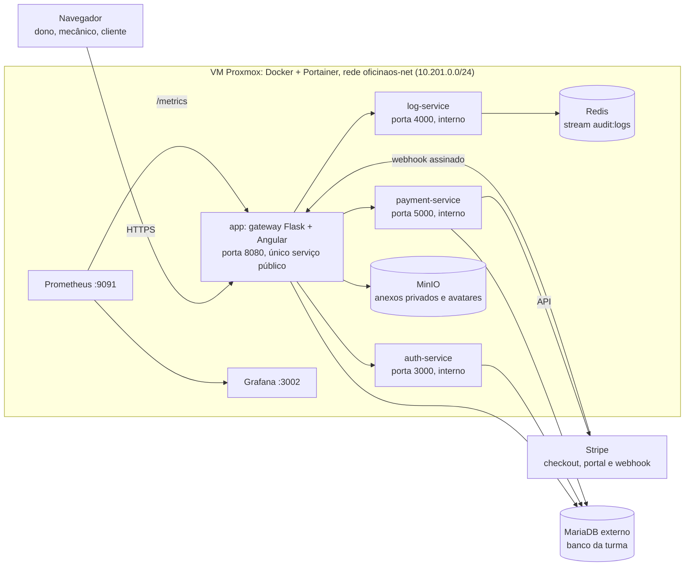

# OficinaOS

> Sistema de ordens de serviço para oficinas mecânicas pequenas: troca o caderno e o WhatsApp por um histórico organizado de clientes, veículos e serviços.

> Projeto da disciplina **ISW055 — Introdução à Computação em Nuvem** (Fatec Pompeia), professor [Allan Siriani](https://github.com/siriani). Aluno: João Victor Serrano.
>
> **Relatório P2:** [docs/P2_ISW055_Joao_Serrano_assinado.pdf](docs/P2_ISW055_Joao_Serrano_assinado.pdf) (disponível na entrega da P2) · **Banco:** [db/](db/) · **API:** `/docs` (Swagger)
>
> **Os valores em R$, horas e quantidades da seção 1 a 7 são estimativas minhas, para raciocinar sobre o negócio. Não vêm de pesquisa ou fonte oficial.**

---

## 1. A dor

**Quem sofre:** o dono de oficina mecânica independente, com 2 a 4 mecânicos, que atende 15 a 25 carros por semana e administra tudo sozinho.

**Quando:** no balcão e no fim do dia. O carro entra, o dono anota num caderno, o cliente manda foto do painel no WhatsApp, o mecânico troca uma peça e ninguém registra. Depois de duas semanas nin[...]

**Como resolve hoje:** caderno de capa dura, planilha que só o dono entende e conversas de WhatsApp com fotos soltas. A "memória do dono" faz o resto.

**Quanto custa (estimativas):**

| Prejuízo | Como acontece | Estimativa |
|---|---|---|
| Dinheiro | Serviço ou peça feito e não anotado, logo não cobrado | R$ 600 a R$ 1.500 por mês |
| Dinheiro | Revisão de retorno esquecida: o cliente não volta e o dono não avisa | 3 a 5 retornos perdidos por mês |
| Tempo | Cliente liga para saber se o carro está pronto | 4 a 6 horas por semana ao telefone |
| Tempo | Procurar no caderno ou no WhatsApp o que foi feito no carro | 10 a 20 minutos por consulta |
| Risco | Sem prova do que foi trocado, o dono perde a discussão do "vocês não fizeram isso" | 1 a 2 disputas por mês |
| Risco | Orçamento mandado por WhatsApp sem resposta clara: o dono executa sem aprovação ou deixa o carro parado | atraso de dias no pátio |

---

## 2. Persona

**Seu Antônio Ferreira, 46 anos**, dono da "Auto Mecânica Ferreira", oficina de bairro numa cidade do interior de São Paulo. Tem 3 mecânicos e atende de 15 a 25 carros por semana. Começou como me[...]

- **Rotina:** abre a oficina às 7h30, recebe os carros, anota no caderno, passa o serviço para o mecânico, responde WhatsApp entre um carro e outro, faz orçamento de cabeça ou numa planilha e fec[...]
- **O que tenta fazer:** saber o que está em andamento, o que foi aprovado, o que está pronto e o que falta cobrar. Avisar o cliente sem precisar ligar.
- **O que atrapalha:** o caderno tem letra de três pessoas; as fotos ficam no celular do mecânico; o cliente pergunta o que foi trocado há seis meses e ele não tem como provar. Já testou um siste[...]

---

## 3. Concorrentes e alternativas

| Alternativa | O que faz bem | O que faz mal |
|---|---|---|
| **Caderno e planilha** | É de graça e todo mundo entende | Não tem histórico por veículo; some, rasga ou molha; não avisa de revisão; só um lugar de leitura |
| **WhatsApp com fotos soltas** | O cliente já usa; é rápido | Informação espalhada em dezenas de conversas; sem status de serviço; sem busca por placa; foto some quando troca de celular |
| **Sistemas de gestão tradicionais** | Têm fiscal, estoque e financeiro | Caros e complexos para oficina de 3 mecânicos; implantação demorada; o dono desiste e volta ao caderno |
| **A memória do dono** | Rápida e sem custo | Esquece peças, valores e datas; não escala; some junto com o dono (férias, doença) |

---

## 4. Proposta de valor

**Para o dono de oficina pequena, o OficinaOS é o jeito mais simples de saber, em dois toques, o que foi feito em cada carro, o que o cliente aprovou e o que falta cobrar, sem caderno, sem planilha e[...]

---

## 5. Modelo de receita (Stripe)

| | **Free** | **Pro — R$ 49/mês** |
|---|---|---|
| Ordens de serviço por mês | até 20 | ilimitadas |
| Mecânicos | 1 | vários |
| Fotos e anexos | até 3 por ordem de serviço | ilimitados |

- **O que o Free limita:** 20 OS por mês cobrem uma oficina que está testando, mas uma oficina com 15 a 25 carros por semana (60 a 100 por mês) passa do limite na primeira semana. Um mecânico apen[...]
- **Por que o dono pagaria:** o limite aparece justamente quando o sistema virou hábito. R$ 49/mês custam menos que um único serviço esquecido de cobrar (estimativa de R$ 600+/mês).
- **Decisão de escopo:** o plano original previa "histórico do veículo de 30 dias" no Free. Não foi implementado: a tabela acima reflete o que o sistema realmente limita (ordens de serviço por m[...]
- **Stripe:** a assinatura usa o Checkout hospedado da Stripe, no **modo de teste** nesta disciplina. Nenhum cartão real é cobrado e o sistema nunca guarda dados de cartão.

---

## 6. Métricas de sucesso

| Métrica | O que mede | Meta do primeiro mês (meta, não resultado) |
|---|---|---|
| Assinantes Pro | Quantas oficinas pagam | 3 |
| MRR | Receita recorrente mensal | R$ 147 (3 × R$ 49) |
| Retenção | Oficinas que continuam ativas no mês seguinte | 70% ou mais |
| OS criadas por oficina ativa | Se o sistema virou hábito | 30 ou mais por mês |

Tudo isso é teste: na disciplina o MRR vem de assinaturas em modo de teste da Stripe.

---

## 7. Lean Canvas

| Bloco | Conteúdo |
|---|---|
| **1. Problema** | Serviços e peças não anotados (e não cobrados); histórico do veículo perdido; cliente liga para saber se o carro está pronto; sem prova do que foi trocado. |
| **2. Segmentos de clientes** | Donos de oficina mecânica independente com 2 a 4 mecânicos e 15 a 25 carros por semana, que hoje usam caderno, planilha e WhatsApp. |
| **3. Proposta única de valor** | O jeito mais simples de saber, em dois toques, o que foi feito em cada carro, o que o cliente aprovou e o que falta cobrar. |
| **4. Solução** | 1) Ordem de serviço com status (aberta, orçamento aprovado, em serviço, pronta, entregue). 2) Histórico do veículo com fotos da entrada e peças trocadas. 3) Orçamento aprov[...] |
| **5. Canais** | Indicação entre donos de oficina; WhatsApp e grupos de mecânicos; landing page com cadastro gratuito; demonstração presencial em oficinas da região. |
| **6. Fontes de receita** | Assinatura Pro de R$ 49/mês via Stripe; plano Free como porta de entrada. |
| **7. Estrutura de custos** | Infra da VM (Proxmox/Docker, custo baixo na disciplina); taxas do Stripe (por cobrança); serviços externos de e-mail; meu tempo de desenvolvimento e suporte. |
| **8. Métricas-chave** | Assinantes Pro, MRR, retenção, OS criadas por oficina ativa. |
| **9. Vantagem injusta** | Já existe uma base pronta e testada (login com papéis, auditoria, upload de fotos, assinatura e observabilidade), então o custo de operar é baixo; histórico acumulado [...] |

---

## 8. O que cada peça do projeto de origem virou

| Peça herdada | O que virou no OficinaOS | Onde está |
|---|---|---|
| Recurso principal do projeto antigo | Ordens de serviço, itens, clientes e veículos | `backend/ordens.py`, `backend/dominio.py` |
| `auth-service` + RBAC (`usuario`/`admin`) | Papéis `admin`, `dono`, `mecanico` e `cliente`, com `oficina_id` | `auth_service/` |
| `log-service` (Redis Streams) | Eventos de negócio com usuário, papel, oficina, recurso e hora | `log_service/`, `/api/auditoria` |
| Avatar e perfil no MinIO | Fotos e comprovantes da OS em bucket **privado** | `backend/ordens.py` (anexos) |
| `payment-service` + Stripe | Plano Pro da oficina (Atividade 11) | `payment_service/` |
| Painel admin de infraestrutura | Continua; ganha painel de planos e MRR de teste (Atividade 11) | `/api/admin/infra/*` |
| Alembic por serviço | Migrações do gateway, do auth e do payment | `backend/migrations`, `auth_service/migrations`, `payment_service/migrations` |
| Swagger por serviço | Todas as rotas novas documentadas, com teste de paridade | `/docs`, `tests/test_swagger.py` |
| CI/CD, GHCR, Portainer | Continua valendo | `.github/workflows/ci-cd.yml` |
| Observabilidade (`/health`, `/metrics`, Grafana) | Continua valendo | `grafana/`, `prometheus.yml` |

---

## 9. Arquitetura atual

O gateway Flask serve também o Angular (build estático em `backend/static`) e é o **único serviço público**. Os demais falam por rede Docker interna.



Detalhes (fluxo de uma requisição, modelo de dados, segurança) em [DOCUMENTACAO.md](DOCUMENTACAO.md). Documento da P1: [P1 ISW055 — João Serrano (assinado)](docs/P1_ISW055_Joao_Serrano_assi[...]

---

## 10. Classificação SaaS / PaaS / IaaS (Atividade 8)

| Peça | Camada | Por quê |
|---|---|---|
| VM Ubuntu no Proxmox | **IaaS** | Recebo uma máquina virtual crua e sou responsável pelo sistema operacional, pelo Docker e pelas atualizações. |
| Docker Engine e rede `oficinaos-net` | **IaaS** | Instalado e mantido por mim dentro da VM; é a infraestrutura sobre a qual os containers rodam. |
| Containers `app`, `auth-service`, `log-service`, `payment-service` | **PaaS** | Só entrego o código e as variáveis de ambiente; a stack sobe, reinicia e é atualizada pelo Portainer sem eu cuidar[...] |
| Redis e MinIO (containers) | **PaaS** | São serviços de plataforma consumidos por API (stream/cache e objetos S3); eu configuro, mas não os desenvolvo. |
| Prometheus e Grafana (containers) | **PaaS** | Plataforma de observabilidade pronta; só forneço configuração e dashboards. |
| Portainer | **PaaS** | Camada de orquestração que recebe o repositório Git e faz o deploy da stack (com webhook do CI/CD). |
| MariaDB externo (banco da turma) | **PaaS** | Banco relacional que me é entregue pronto; eu uso o schema, mas não administro o servidor. |
| Stripe (Checkout, portal, webhook) | **SaaS** | Serviço de pagamentos completo, consumido pela internet; o cartão é digitado na página da Stripe, não no meu sistema. |
| Google OAuth | **SaaS** | Login federado fornecido pronto pelo Google. |
| Mailtrap (SMTP de e-mail transacional) | **SaaS** | Serviço de e-mail usado só para enviar o link de recuperação de senha. |
| GitHub, GitHub Actions e GHCR | **SaaS** | Hospedagem do código, pipeline de CI/CD e registro de imagens, tudo como serviço. |

> A classificação do MariaDB assume que ele é um servidor gerenciado pela turma (README: "banco de dados relacional oficial da turma"); se for uma VM minha, ele passa a ser IaaS.

---

## 11. Papéis e permissões

O papel e a oficina vêm sempre do `auth-service` (rota `/me`), nunca do corpo ou da URL da requisição. A permissão é checada **no backend**, mesmo chamando a API direto; cada tentativa negad[...]

| Ação | `admin` | `dono` | `mecanico` | `cliente` |
|---|:-:|:-:|:-:|:-:|
| Criar a oficina, ver código de convite e equipe | ❌ | ✅ | ❌ | ❌ |
| Cadastrar cliente e veículo | ❌ | ✅ | ❌ | ❌ |
| Ver clientes e veículos da oficina | ❌ | ✅ | ✅ (leitura) | só os próprios veículos |
| Abrir ordem de serviço | ❌ | ✅ | ✅ (fica atribuída a ele) | ❌ |
| Ver ordens de serviço | ❌ | todas da oficina | só as atribuídas a ele | só as dos próprios veículos |
| Editar OS, adicionar itens e fotos | ❌ | ✅ | ✅ (as atribuídas) | ❌ |
| Enviar orçamento (versões, desconto, validade) | ❌ | ✅ | ❌ | ❌ |
| Aprovar ou recusar orçamento | ❌ | ✅ (pelo cliente, por telefone) | ❌ | ✅ (o próprio veículo, no app ou pelo link sem login) |
| Anotações internas da OS | ❌ | ✅ | ✅ (as atribuídas) | ❌ |
| Catálogo de serviços e peças | ❌ | ✅ | leitura | ❌ |
| Registrar pagamento e ver o financeiro do mês | ❌ | ✅ | ❌ | ❌ |
| Histórico do veículo | ❌ | ✅ (com pago e devido) | ✅ (as atribuídas) | ✅ (o próprio veículo, sem valores pagos) |
| Iniciar serviço e marcar como pronta | ❌ | ✅ | ✅ (as atribuídas) | ❌ |
| Entregar veículo, cancelar e excluir OS | ❌ | ✅ | ❌ | ❌ |
| Auditoria da oficina | ❌ | ✅ | ❌ | ❌ |
| Log de todas as oficinas e painel da plataforma | ✅ | ❌ | ❌ | ❌ |

**Isolamento:** toda tabela do domínio tem `oficina_id` (direto ou via `os_id`) e toda consulta passa por `backend/escopo.py`. Abrir o ID de outra oficina responde **404** (sem revelar que o registro[...]

**Status da OS:** `aberta` → `orcamento_aprovado` → `em_servico` → `pronta` → `entregue` (e `cancelada`, só pelo dono, antes de entregar).

### Do orçamento à entrega

- **Catálogo:** o dono cadastra serviços e peças com preço padrão (`/app/catalogo`); na OS, "Adicionar do catálogo" inclui o item com um clique (o valor continua editável).
- **Orçamento com versões:** os itens da OS são o rascunho. "Enviar orçamento" tira uma foto dos itens com desconto, validade (1 a 90 dias) e observações para o cliente. Reenviar cria a versão [...]
- **Link do cliente:** cada envio gera um link `/orcamento/<token>` (o banco guarda só o hash do token). O cliente abre sem login, imprime ou salva em PDF e aprova ou recusa (com motivo). A resposta [...]
- **Km, pagamento e histórico:** a OS registra o km de entrada. Com a OS pronta ou entregue, o dono registra os pagamentos (Pix, dinheiro, cartão, boleto) até o valor devido (total menos o desconto[...]
- **Financeiro do mês** (`/app/financeiro`): faturado pelo dia do pagamento, por forma, OS entregues, ticket médio e o total a receber hoje.

**Cadastro:** "Sou dono" cria a oficina; "Sou mecânico" e "Sou cliente" pedem o **código de convite**, mostrado ao dono na tela Equipe.

## 12. Planos e limites

| | Free | Pro (R$ 49/mês) |
|---|---|---|
| Ordens de serviço por mês (fuso America/Sao_Paulo; excluir não devolve a cota) | 20 | sem limite |
| Mecânicos | 1 | sem limite |
| Anexos por OS | 3 | sem limite |

Ao passar do limite a API responde **402** com `{erro, codigo: "limite_plano", limite, uso, plano, como_liberar}` e registra `plano.limite_atingido`. A decisão usa o plano **lido do banco a cada requ[...]

### Assinatura Pro (Atividade 11, Stripe **somente em modo de teste**)

**Adaptação ao tenant:** aqui quem assina é a **oficina**, não o usuário. O customer da Stripe e a assinatura ficam na tabela `assinaturas` (uma linha por oficina, `oficina_id` único), ligados a[...]

**Fluxo (roteiro do professor):**
1. Cria a conta como dono: a oficina nasce **Free**.
2. Chega a 20 OS no mês: a 21ª é recusada (402) com a mensagem do plano e o botão **Assinar Pro**.
3. Em **Plano e assinatura** (`/app/plano`) o dono clica em *Assinar Pro*: o gateway cria o Checkout (`client_reference_id` e metadata levam a oficina) e redireciona para a Stripe. Cartão de teste: [...]
4. Na volta a tela mostra “processando…”: o plano **só muda quando o webhook chega**, nunca pelo retorno do navegador.
5. *Gerenciar assinatura* abre o Billing Portal; o cancelamento imediato está habilitado no painel da Stripe para o teste. O webhook `customer.subscription.deleted` devolve a oficina ao Free.
6. O admin da plataforma vê em `/app/admin` as oficinas e usuários por plano, as assinaturas ativas, o **MRR de teste** (soma mensal das assinaturas ativas) e os últimos eventos.

**Webhooks** (`POST /api/payment/webhook`, assinatura `Stripe-Signature` sempre validada; inválida → 400): `checkout.session.completed` (salva customer e subscription e muda para Pro), `customer.su[...]

**Como testar o webhook localmente** (com a Stripe CLI e chaves `sk_test_`/`pk_test_` no `.env`):

```bash
stripe login
stripe listen --forward-to localhost:8080/api/payment/webhook   # copie o whsec_... para STRIPE_WEBHOOK_SECRET
stripe trigger invoice.payment_failed                            # ou conclua um checkout real com o cartão 4242
python scripts/cenarios/ativ11.py --base-url http://localhost:8080
```

Sem a Stripe CLI, os testes automatizados (`pytest tests/test_webhooks_assinatura.py`) assinam payloads com um segredo fictício e cobrem os quatro eventos.

## 13. Como executar localmente

```bash
python3 -m venv venv && . venv/bin/activate
pip install -r requirements.txt -r auth_service/requirements.txt -r log_service/requirements.txt -r payment_service/requirements.txt pytest
pytest tests/ -v          # usa os mesmos envs fictícios do CI (veja .github/workflows/ci-cd.yml)

cp .env.example .env      # preencha os valores; nunca versione o .env
docker compose -f docker-compose.yml -f docker-compose.dev.yml up -d --build   # MariaDB local + stack
./scripts/build_frontend.sh                                                     # recompila o Angular em backend/static
python scripts/cenarios/ativ10.py --base-url http://localhost:8080              # cenário de aceite da A10
python scripts/cenarios/ativ12.py --base-url http://localhost:8080              # orçamento, link, pagamento e financeiro
```

No Portainer a stack usa o `docker-compose.yml` (sem o override de desenvolvimento) e o banco MariaDB da turma; as variáveis ficam na seção *Environment* da stack.

## 14. Banco de dados

O banco do domínio é recriável a partir do repositório. As tabelas novas (`oficinas`, `clientes`, `veiculos`, `ordens_servico`, `itens_os`, `anexos_os`) têm chaves estrangeiras e são criadas pel[...]

## 15. Variáveis de ambiente

Somente **nomes** (os valores ficam no `.env` local ou na stack do Portainer): consulte [`.env.example`](.env.example). Obrigatórias: `DB_*`, `FLASK_SECRET_KEY`, `AUTH_SECRET_KEY`, `INTERNAL_TOKEN`, [...]

## 16. Qualidade: testes, Swagger e CI/CD

- **Testes:** `pytest tests/ -v` cobre papéis (403), isolamento por oficina (404), limites do plano (402), máquina de estados (409), anexos (tipo pelo conteúdo, tamanho, bucket privado), eventos de[...]
- **Swagger:** `/docs` agrega gateway, auth e log; `tests/test_swagger.py` falha se uma rota existir sem documentação (e vice-versa). Regenerar `openapi.json/yaml`: `python scripts/generate_openapi.[...]
- **CI/CD:** push na `main` roda os testes, publica as imagens `oficinaos-*` no GHCR e aciona o webhook do Portainer, com smoke test em `/health`.
- **Observabilidade:** `/health` com readiness real, `/metrics` e dashboard no Grafana.

## 17. Histórico do projeto

O OficinaOS nasceu como **fork com histórico completo** do catálogo de filmes usado nas Atividades 1 a 8 ([github.com/JoaoVSerrano/tomhanks](https://github.com/JoaoVSerrano/tomhanks)). A Atividade 1[...]

